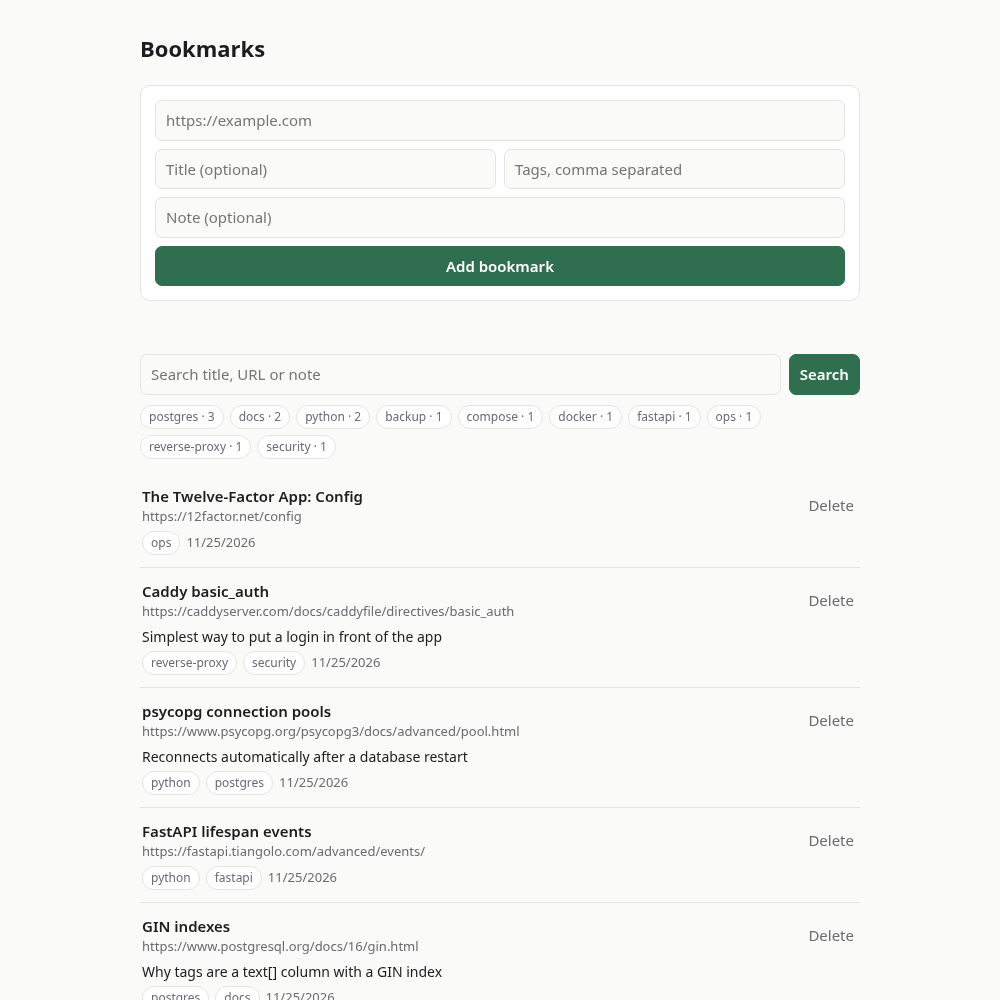
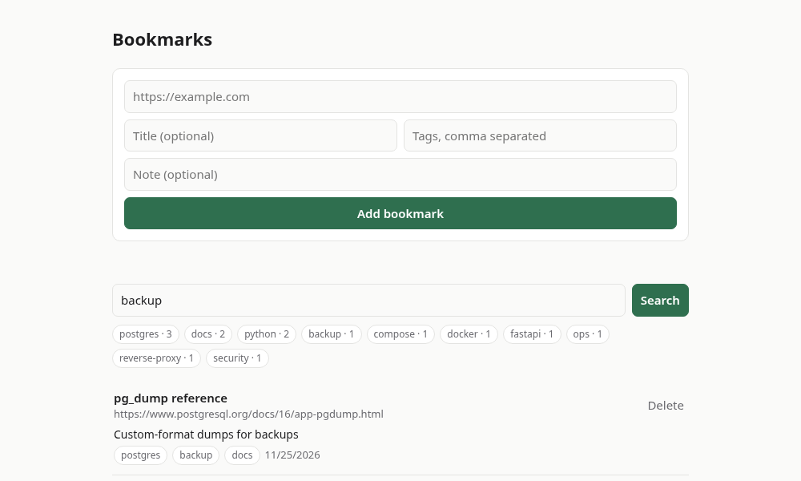
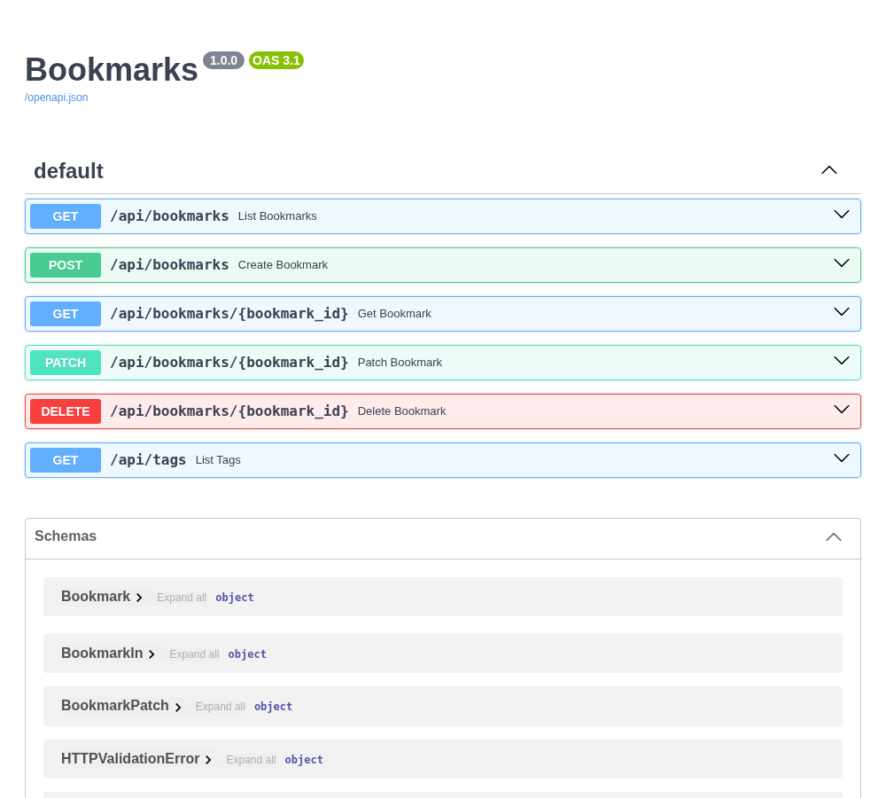

# Bookmarks

A small self-hosted bookmark manager. Add links, tag them, search them and
delete them, either in the web UI or through a JSON API. It's built for one
person or a small team on a single host.

- **Web UI:** `http://localhost:8080/`
- **JSON API:** `http://localhost:8080/api/...`; interactive docs at `/docs`
- **Health:** `http://localhost:8080/health`



## What it does

- **Add** a link with an optional title, note and tags. URLs must be `http(s)`,
  and adding the same URL twice is rejected.
- **Tag** bookmarks. Tags are normalised (lower-cased, trimmed, de-duplicated),
  shown with counts, and clickable to filter. Re-tag later via `PATCH` in the API.
- **Search** across URL, title and note (case-insensitive substring).
- **Delete** with a confirmation prompt.
- **Share filtered views:** the page keeps the search and tag in the address bar,
  e.g. `/?tag=postgres` or `/?q=backup`.
- Everything the UI does goes through the same **JSON API**, documented at `/docs`.
- It follows the system's **light/dark** setting.

## Screenshots

| Filter by tag (`/?tag=postgres`) | Search (`/?q=backup`) |
|---|---|
|  |  |

| Dark mode | Interactive API docs (`/docs`) |
|---|---|
|  |  |

## Demo (terminal)

Real output from the running stack:

```console
$ docker compose ps
NAME              IMAGE                   STATUS                    PORTS
bookmarks-app-1   bookmarks-app:1.0.0     Up 32 seconds (healthy)   127.0.0.1:8080->8000/tcp
bookmarks-db-1    postgres:16.11-alpine   Up 15 minutes (healthy)   5432/tcp

$ curl localhost:8080/health
{"status":"ok","database":"ok"}

$ curl -X POST localhost:8080/api/bookmarks -H 'Content-Type: application/json' \
    -d '{"url":"https://docs.docker.com/engine/storage/volumes/","title":"Docker volumes","tags":["Docker"," docs "]}'
{"id":11,"url":"https://docs.docker.com/engine/storage/volumes/","title":"Docker volumes","description":"","tags":["docker","docs"],"created_at":"2026-11-25T12:54:01.713471Z"}

$ curl -X POST localhost:8080/api/bookmarks -H 'Content-Type: application/json' -d '{"url":"javascript:alert(1)"}'
{"detail":[{"type":"value_error","loc":["body","url"],"msg":"Value error, must be an absolute http:// or https:// URL", ...}]}
```

`"Docker"` and `" docs "` were stored as `docker` and `docs`. The database's
`5432/tcp` is only reachable on the internal network; nothing is published to the host.

## Quick start

Requires Docker Engine with the Compose plugin (v2.20+).

```bash
git clone <your-repo-url> bookmarks && cd bookmarks
cp .env.example .env          # edit POSTGRES_PASSWORD if you expose it beyond localhost
docker compose up -d --build
docker compose ps             # both services should show "(healthy)" within ~30 s
```

Open <http://localhost:8080>.

## Technologies used

| Area | Technology | Version | Why |
|---|---|---|---|
| Language | Python | 3.12 | Readable, and the whole app is ≈400 lines |
| Web framework | FastAPI (on Starlette) | 0.115.6 | Request validation and OpenAPI/Swagger docs come built in |
| Validation | Pydantic | 2.10.4 | Request/response models; rejects bad URLs and tags with clear 422 errors |
| HTTP server | Uvicorn | 0.34.0 | Standard ASGI server for FastAPI |
| DB driver | psycopg 3 (binary) + psycopg-pool | 3.2.3 / 3.2.4 | The standard Postgres driver. Bundles libpq, so the image needs no compiler or apt packages; the pool reconnects after DB restarts |
| Database | PostgreSQL | 16.11 (`alpine`) | As requested. Tags are a `text[]` column with a GIN index, so no join table is needed |
| Frontend | HTML, CSS, plain JavaScript | — | One static page, no build step or Node toolchain; uses the same JSON API |
| Container | Docker, multi-stage `Dockerfile` | base `python:3.12.12-slim-bookworm` | Slim, non-root (uid 10001), read-only filesystem |
| Orchestration | Docker Compose | v2.20+ | Health checks, `depends_on: service_healthy`, named volume, internal network |
| Backups | `pg_dump` / `pg_restore` (custom format) | from the Postgres image | Consistent online backups; single-transaction restore |
| Tests | pytest, httpx (FastAPI `TestClient`) | 8.3.4 / 0.28.1 | Config unit tests plus API integration tests against real Postgres |

The schema is created automatically on startup (`CREATE TABLE IF NOT EXISTS`), so
there is no separate migration step.

## Environment variables

All configuration comes from `.env`, which Compose reads automatically. Every
variable has a safe default in `.env.example`.

| Name | Required | Default (`.env.example`) | Description |
|---|---|---|---|
| `POSTGRES_USER` | **yes** | `bookmarks` | Database user. Creates the user on first start; the app connects with it. |
| `POSTGRES_PASSWORD` | **yes** | `change-me-local-only` | Database password. **Change it** before exposing the app beyond localhost (`openssl rand -base64 24`). |
| `POSTGRES_DB` | **yes** | `bookmarks` | Database name. |
| `APP_BIND_ADDRESS` | no | `127.0.0.1` | Host interface the app is published on. `127.0.0.1` = this machine only; `0.0.0.0` = all interfaces (the app has no login, see [Reverse proxy](#putting-it-behind-a-reverse-proxy--tls--auth)). |
| `APP_PORT` | no | `8080` | Host port for the UI/API. |
| `LOG_LEVEL` | no | `info` | `critical`, `error`, `warning`, `info` or `debug`. |
| `DB_POOL_SIZE` | no | `5` | Maximum DB connections the app keeps open. |

If a required variable is missing, it fails fast at two levels:

- `docker compose up` refuses to start and prints, e.g., `POSTGRES_PASSWORD is required - copy .env.example to .env`.
- The app itself validates its config before starting and exits with a list of
  every missing or invalid variable (`FATAL: Invalid configuration: - DB_PASSWORD is required but not set ...`).

Internally, Compose maps the `POSTGRES_*` values to the app's `DB_HOST`, `DB_PORT`,
`DB_NAME`, `DB_USER` and `DB_PASSWORD`. You don't set those yourself unless you run
the app outside Compose.

## JSON API

| Method | Path | Body / query | Result |
|---|---|---|---|
| `GET` | `/api/bookmarks` | `?q=text&tag=name&limit=100&offset=0` | List, newest first. `q` searches URL, title and note; `tag` filters by tag. |
| `POST` | `/api/bookmarks` | `{"url", "title"?, "description"?, "tags"?: []}` | `201` with the bookmark; `409` if the URL already exists; `422` if invalid. |
| `GET` | `/api/bookmarks/{id}` | | Bookmark or `404`. |
| `PATCH` | `/api/bookmarks/{id}` | any of `title`, `description`, `tags` | Updated bookmark (use this to re-tag). |
| `DELETE` | `/api/bookmarks/{id}` | | `204` or `404`. |
| `GET` | `/api/tags` | | `[{"tag", "count"}]`. |
| `GET` | `/health` | | `200 {"status":"ok"}` only if the DB answers `SELECT 1`, else `503`. |

```bash
curl -X POST localhost:8080/api/bookmarks -H 'Content-Type: application/json' \
  -d '{"url":"https://www.postgresql.org/docs/16/","title":"Postgres docs","tags":["db","docs"]}'
curl 'localhost:8080/api/bookmarks?q=postgres'
curl 'localhost:8080/api/bookmarks?tag=docs'
curl -X DELETE localhost:8080/api/bookmarks/1
```

Rules: URLs must be absolute `http://` or `https://`. Tags are lower-cased and
de-duplicated, at most 20 per bookmark, 50 characters each, and no commas.

## Data, backup, restore, upgrade

### Where data lives

All state lives in PostgreSQL, in the named volume **`bookmarks_pgdata`**
(mounted at `/var/lib/postgresql/data`). The app container is stateless and its
filesystem is read-only. The app has no file uploads, so no other volume is needed.

- `docker compose down` and then `docker compose up -d` keeps your data.
- `docker compose down -v` **deletes the volume and all bookmarks.** Don't use `-v` unless you mean it.

```bash
docker volume inspect bookmarks_pgdata   # shows where Docker keeps it on disk
```

### Backup

```bash
scripts/backup.sh                         # -> backups/bookmarks-20260101T120000Z.dump
```

This runs `pg_dump --format=custom` inside the `db` container while everything
stays online. Dumps go to `./backups/`, which git ignores. Copy them off the host
regularly. A nightly cron job could look like this:

```cron
15 3 * * * cd /opt/bookmarks && scripts/backup.sh >/dev/null && find backups -name '*.dump' -mtime +30 -delete
```

The same thing without the script:

```bash
docker compose exec -T db sh -c 'pg_dump -Fc -U "$POSTGRES_USER" -d "$POSTGRES_DB"' > backup.dump
```

### Restore

```bash
scripts/restore.sh backups/bookmarks-20260101T120000Z.dump        # asks for confirmation
scripts/restore.sh backups/bookmarks-20260101T120000Z.dump --yes  # non-interactive
```

The script stops the app, restores the dump in a single transaction (replacing
current data), then restarts the app and waits until it's healthy. The manual
equivalent:

```bash
docker compose stop app
docker compose exec -T db sh -c 'pg_restore --clean --if-exists --no-owner --single-transaction -U "$POSTGRES_USER" -d "$POSTGRES_DB"' < backup.dump
docker compose up -d app
```

### Upgrade

**App or Postgres minor version** (e.g. `16.11` → `16.12`; the data format is compatible):

```bash
scripts/backup.sh                # always back up first
git pull                         # or edit the image tag in compose.yaml
docker compose up -d --build     # rebuilds the app and recreates changed containers
docker compose ps                # wait for "(healthy)"
```

**Postgres major version** (e.g. 16 → 17) needs a dump and restore, because the
on-disk format changes:

```bash
scripts/backup.sh
docker compose down
docker volume rm bookmarks_pgdata                  # data is now only in the backup
# edit compose.yaml: image: postgres:17.x-alpine
docker compose up -d --wait db
scripts/restore.sh backups/<latest>.dump --yes
```

## Health checks and logs

```bash
docker compose ps                         # STATUS shows (healthy) / (unhealthy) / (health: starting)
curl -i localhost:8080/health             # 200 when the app can reach the DB, 503 otherwise
docker inspect --format '{{json .State.Health}}' bookmarks-app-1   # last health check results

docker compose logs -f                    # all services
docker compose logs -f app                # just the app
docker compose logs --since 10m db        # recent DB logs
```

- **`db`** is checked with `pg_isready` over TCP. TCP is used so the check stays
  unhealthy during first-time initialisation, when Postgres only listens on a socket.
- **`app`** is checked by calling `GET /health` from inside the container. That
  endpoint runs `SELECT 1` against the database.
- **`app` waits for the database:** it uses `depends_on: db: condition: service_healthy`.
  If the DB still can't be reached within 30 s of startup, the app exits and
  `restart: unless-stopped` tries again.
- **If the DB goes down while the app is running:** `/health` returns `503` and API
  calls return `503 {"detail":"database unavailable"}`. Both recover by themselves
  a few seconds after the DB is back.

## Putting it behind a reverse proxy / TLS / auth

The app has **no authentication**, which is why it binds to `127.0.0.1` by default.
To reach it from other machines, put a reverse proxy in front that terminates TLS
and adds authentication (basic auth, or forward-auth such as Authelia,
oauth2-proxy or Authentik). Then leave `APP_BIND_ADDRESS=127.0.0.1` so the
proxy is the only way in.

Caddy example (gets TLS certificates automatically):

```caddyfile
bookmarks.example.com {
    basic_auth {
        # generate with: caddy hash-password
        alice $2a$14$...
    }
    reverse_proxy 127.0.0.1:8080
}
```

nginx example:

```nginx
server {
    listen 443 ssl;
    server_name bookmarks.example.com;
    ssl_certificate     /etc/letsencrypt/live/bookmarks.example.com/fullchain.pem;
    ssl_certificate_key /etc/letsencrypt/live/bookmarks.example.com/privkey.pem;
    auth_basic           "Bookmarks";
    auth_basic_user_file /etc/nginx/bookmarks.htpasswd;
    location / {
        proxy_pass http://127.0.0.1:8080;
        proxy_set_header Host $host;
        proxy_set_header X-Forwarded-Proto $scheme;
    }
}
```

If the proxy runs in Docker on the same host, you can instead attach it to this
project's `frontend` network, proxy to `app:8000`, and remove the `ports:`
mapping from `compose.yaml`. The app serves everything from `/`, so mount it on
its own (sub)domain rather than a sub-path.

## Common problems

| Symptom | Cause | Fix |
|---|---|---|
| `required variable POSTGRES_PASSWORD is missing a value` | No `.env` file | `cp .env.example .env` |
| `Bind for 127.0.0.1:8080 failed: port is already allocated` | Something else uses port 8080 | Set `APP_PORT=8081` (or any free port) in `.env`, then `docker compose up -d` |
| App keeps restarting, logs say `password authentication failed for user` | `POSTGRES_PASSWORD`/`POSTGRES_USER` were changed after the first start. Postgres only reads them when it creates the volume. | Put the old values back, **or** change the password inside the DB: `docker compose exec db sh -c 'psql -U "$POSTGRES_USER" -d "$POSTGRES_DB" -c "ALTER USER \"$POSTGRES_USER\" PASSWORD '\''new-password'\''"'` and then update `.env`. On a fresh install with no data, `docker compose down -v` also works. |
| `app` stuck in `health: starting` or `unhealthy` | DB not reachable or still initialising | `docker compose logs db app`; `docker compose ps` shows whether `db` is healthy |
| `dependency failed to start: container bookmarks-db-1 is unhealthy` | Postgres failed to start, often from a corrupt or incompatible volume (e.g. switching major versions) | `docker compose logs db`. For a major-version change, follow the upgrade steps above. |
| UI loads but can't be reached from another machine | Bound to `127.0.0.1` by default | Use a reverse proxy (recommended), or set `APP_BIND_ADDRESS=0.0.0.0` on a trusted network |
| Data disappeared after restart | `docker compose down -v` was used, or the project folder (and so the project/volume name) was renamed | `docker volume ls`: the old volume is `<old-folder-name>_pgdata` unless removed. The project name is pinned to `bookmarks` in `compose.yaml` to avoid this. |
| `restore.sh`: `pg_restore: error: input file does not appear to be a valid archive` | The file isn't a `pg_dump -Fc` dump (e.g. an empty or partial file) | Use a `.dump` file produced by `backup.sh`; check its size is not 0 |

## Problems encountered and solved

Real issues hit while building and testing this project, in roughly the order they came up.

1. **Pydantic v2 ignored my validators.** I first attached validators as
   underscore-prefixed class attributes (`_url = field_validator(...)`).
   Pydantic v2 treats attributes starting with `_` as private and silently skips
   them, so invalid URLs would have been accepted. **Fix:** standard
   `@field_validator` + `@classmethod` methods. A test now checks that
   `javascript:` URLs and comma-containing tags return 422.

2. **No Docker on the build machine at first.** The app still had to be tested
   against a real database. **Fix:** I unpacked Debian's PostgreSQL package into
   a scratch directory and ran it as a normal user (no root, no install), then ran
   the integration tests against it. Two sub-problems came up:
   - Postgres refused to start because its Unix socket path was over the 107-byte
     limit. **Fix:** disabled Unix sockets (`-k ''`) and used TCP only.
   - The "DB is down" test closed the connection pool and tried to reopen it,
     which psycopg-pool doesn't allow. **Fix:** the test swaps in a pool pointing
     at a port nobody listens on, which is also closer to a real outage.

3. **Requests hung for 30 seconds while the database was down.** Stopping Postgres
   under the running app showed `/health` correctly returning 503, but API calls
   waited for the pool's default 30 s timeout. **Fix:** pool `timeout=10`, so
   clients get a `503 database unavailable` quickly. The pool reconnects by itself
   about 4 s after the DB returns.

4. **Health check could pass before the database was ready.** On first start, the
   official Postgres image runs a temporary server for initialisation that only
   listens on a Unix socket, so a socket-based `pg_isready` can report "ready" too
   early. **Fix:** the health check uses `-h 127.0.0.1` (TCP), which only answers
   once the real server is up. That keeps the app from starting against a
   half-initialised database.

5. **Unreadable buttons in dark mode.** A design check flagged white text on the
   light-green dark-mode accent (about 2:1 contrast, below WCAG AA). **Fix:** a
   separate `--on-accent` colour (dark text on the dark-theme accent).

6. **`permission denied` on `/var/run/docker.sock`.** Once Docker was installed,
   both my shell and the user's terminal were refused, even though the user was in
   the `docker` group. Group membership only applies to sessions started *after*
   you're added. **Fix:** `sg docker -c "..."` (or `newgrp docker`) for the current
   session; logging out and in fixes it permanently.

7. **Missing-`.env` error without a hint.** With no `.env`, Compose reported the
   app's variable lines first, and those lacked the "copy .env.example to .env"
   hint that the database's lines had. **Fix:** every required-variable error now
   includes the hint.

8. **Screenshots of filtered views.** Headless Chromium can't click, and the
   filter state lived only in JavaScript. **Fix:** the page now syncs its search
   and tag to the URL (`/?tag=postgres`). That made the screenshots scriptable and
   gave users shareable filtered views.

Things I checked that turned out fine: after a restore, new inserts don't
collide on IDs (`pg_dump` restores the identity sequence); LIKE wildcards in
searches (`%`, `_`) are escaped; and the app container really is non-root with a
read-only filesystem, while the database has no internet route.

## Development

Run the tests against any PostgreSQL. The API tests empty the `bookmarks` table,
so use a throwaway database:

```bash
python -m venv .venv && . .venv/bin/activate
pip install -r requirements.txt pytest==8.3.4 httpx==0.28.1
pytest -q                                            # config tests only
DB_HOST=127.0.0.1 DB_PORT=5432 DB_NAME=bookmarks_test DB_USER=postgres DB_PASSWORD=... pytest -q   # + API tests
```

Run the app outside Docker with `DB_HOST=... DB_NAME=... DB_USER=... DB_PASSWORD=... python -m app`.
It listens on port 8000.

## Project layout

```
app/
  __main__.py     entrypoint: validate env, start uvicorn
  config.py       env-var loading + fail-fast validation
  db.py           connection pool, schema, SQL queries
  main.py         FastAPI routes, request validation, /health
  static/index.html   the web UI (plain HTML + JS)
scripts/backup.sh, scripts/restore.sh
tests/test_app.py
docs/screenshots/    images used in this README
Dockerfile, compose.yaml, .env.example
```
