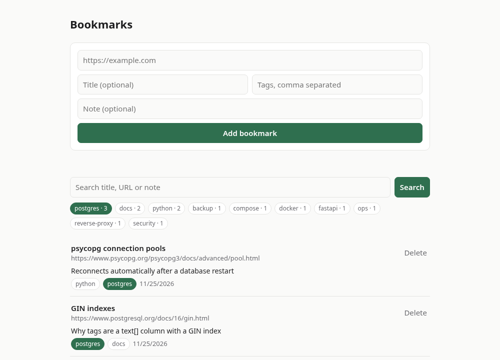
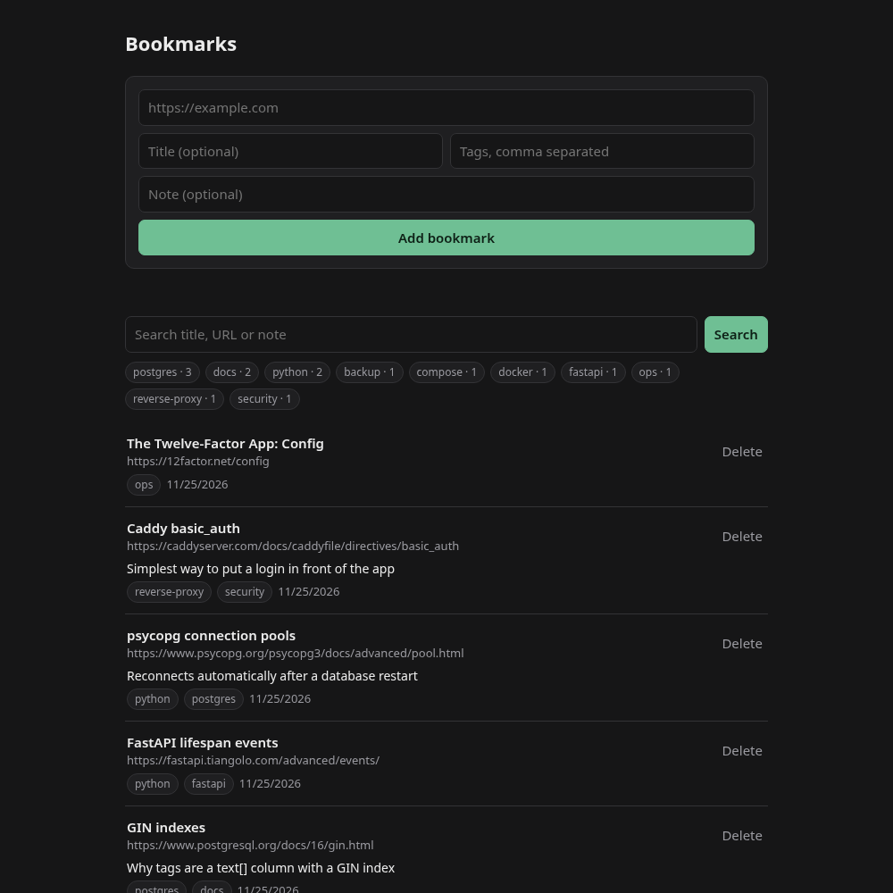

# Bookmarks

A self-hosted bookmark manager with a web UI and a JSON API, packaged as a
health-checked Docker Compose stack.

## Overview

Bookmarks lets one person or a small team save links, tag them, search them and
delete them, from the browser or through a REST API. The links live in a
PostgreSQL database on your own server, so they aren't tied to one browser
profile or a third-party service, and you can back them up with one script.

One `docker compose up -d` starts a FastAPI app and PostgreSQL 16, each with a
health check. The containers run as non-root, the app's filesystem is read-only,
the database sits on a network with no outside access, and 11 tests run against
a real Postgres.

## Demo


| Filter by tag (`/?tag=postgres`) | Search (`/?q=backup`) |
|---|---|
|  |  |

| Dark mode (follows the system setting) | Interactive API docs at `/docs` |
|---|---|
|  |  |

<!-- PLACEHOLDER: record docs/images/demo.gif (add a bookmark with tags, click a tag to filter, delete it) -->


<!-- PLACEHOLDER: screenshot of a terminal running `docker compose ps` with both services "(healthy)" -->


## Tech stack

- **Python 3.12:** the whole app is about 400 lines.
- **FastAPI 0.115 + Uvicorn:** HTTP routes and the server; FastAPI also generates the interactive API docs at `/docs`.
- **Pydantic 2:** validates request bodies and returns a 422 for non-`http(s)` URLs or malformed tags.
- **psycopg 3 + psycopg-pool:** PostgreSQL driver and connection pool. The binary wheel bundles libpq, so the image needs no compiler, and the pool reconnects on its own after a database restart.
- **PostgreSQL 16:** storage. Tags are a `text[]` column with a GIN index, so no join table is needed.
- **HTML, CSS and plain JavaScript:** a single-page UI with no build step, using the same JSON API as any other client.
- **Docker (multi-stage build):** slim Python base image, non-root user (uid 10001), read-only filesystem, all Linux capabilities dropped.
- **Docker Compose:** health checks for both services, `depends_on: service_healthy` so the app waits for the database, a named volume for data, and an internal network for the database.
- **pg_dump / pg_restore:** the backup and restore scripts in `scripts/`.
- **pytest + httpx:** config unit tests, plus API integration tests against a real PostgreSQL.

## Getting started

Prerequisites: Git, and Docker Engine with the Compose plugin v2.20 or newer.

```bash
git clone https://github.com/undefinedcringe/bookmarks.git
cd bookmarks
cp .env.example .env
docker compose up -d
docker compose ps
```

After about 30 seconds both services show `(healthy)`. Open
<http://localhost:8080> for the UI or <http://localhost:8080/docs> for the API.

The defaults in `.env.example` work as they are. Change `POSTGRES_PASSWORD` before
exposing the app beyond your own machine; it listens on `127.0.0.1` only by default.

Stop it without losing data:

```bash
docker compose down
```

Back up and restore:

```bash
scripts/backup.sh
scripts/restore.sh backups/<file>.dump
```

Run the tests (the API tests need a throwaway PostgreSQL database, because they empty the table):

```bash
python3 -m venv .venv && . .venv/bin/activate
pip install -r requirements.txt pytest==8.3.4 httpx==0.28.1
DB_HOST=127.0.0.1 DB_PORT=5432 DB_NAME=bookmarks_test DB_USER=postgres DB_PASSWORD=yourpassword pytest -q
```

Every environment variable, the API reference, upgrades, logs, putting it behind
a reverse proxy with TLS, and troubleshooting are in
[docs/DEPLOYMENT.md](docs/DEPLOYMENT.md).

## Challenges & solutions

### The API hung for 30 seconds when the database went down

**Problem:** I stopped Postgres under the running app to see how it failed.
`/health` switched to 503 right away, but every API request waited 30 seconds
before erroring.

**What I tried:** The app log showed `couldn't get a connection after 30.00 sec`.
Requests were queuing for a pool connection with the pool's default wait, while
`/health` used its own 3-second limit.

**What worked:** A pool-wide `timeout=10`. Requests now fail with
`503 database unavailable` within 10 seconds, and when Postgres comes back the
pool reconnects by itself. `/health` returned 200 again about 4 seconds later,
with no restart.

**What I learned:** A green health check doesn't tell you how long real requests
wait. Stopping the dependency on purpose and timing the result does.

### Integration tests needed a real Postgres on a machine without Docker

**Problem:** I wanted the API tests to hit real PostgreSQL instead of mocks, but
Docker wasn't installed yet, and I didn't want to install a database system-wide.

**What I tried:** `pgserver`, which bundles Postgres in a pip package, had no wheel
for the machine's Python 3.13. `postgresql-wheel` wasn't on PyPI at all.

**What worked:** I downloaded Debian's own `postgresql-17` package with
`apt-get download`, unpacked it into a scratch folder with `dpkg-deb -x`, and ran
`initdb` and `pg_ctl` as a normal user. Postgres then refused to start because
its Unix socket path was longer than the 107-byte limit. Turning sockets off
(`-k ''`) and connecting over TCP fixed that. The same SQL later ran unchanged on
PostgreSQL 16 in the Compose stack.

**What I learned:** A distribution package can run straight from any folder. Unix
socket paths have a hard length limit, and deeply nested temp folders exceed it
easily.

### Simulating a database outage inside a test

**Problem:** My test for "`/health` returns 503 when the database is down"
closed the app's connection pool and then reopened it for the next tests.
psycopg-pool doesn't allow that: a closed pool can't be reopened.

**What I tried:** A second pool pointed at a port nothing listens on, created
with `min_size=0`. It raised a `ValueError` until I also set `max_size=1`.

**What worked:** The test swaps that dead pool in, checks for the 503, then puts
the real pool back and checks for a 200. That's also closer to a real outage:
the app can't connect, which is different from shutting down its own pool.

**What I learned:** Fake failures at the boundary, the network connection, rather
than by breaking shared state the rest of the suite depends on.

### Pydantic v2 would have skipped URL validation

**Problem:** I first attached my validators to underscore-prefixed class
attributes (`_url = field_validator("url")(...)`). Pydantic v2 treats names that
start with `_` as private attributes, so those validators would never run. A
`javascript:` URL would have been saved and rendered as a clickable link.

**What I tried:** I caught it reading the models back before the first test run.

**What worked:** Plain `@field_validator` methods with `@classmethod`. The tests
now post a `javascript:` URL, a non-URL and a tag containing a comma, and expect
a 422 for each.

**What I learned:** In Pydantic v2 a leading underscore changes what an attribute
is. Each validation rule needs a test that actually sends the bad input.

### `permission denied` on the Docker socket after installing Docker

**Problem:** With Docker installed and my user in the `docker` group, every
`docker` command in my open terminals still failed with `permission denied` on
`/var/run/docker.sock`.

**What I tried:** `getent group docker` listed my user, but `id -nG` in the same
terminal didn't include `docker`.

**What worked:** `sg docker -c "..."` (or `newgrp docker`) runs commands with the
new group in the current session. Logging out and back in fixes it for good.

**What I learned:** A process gets its group list at login, so sessions that were
already open don't see a group you were just added to.
